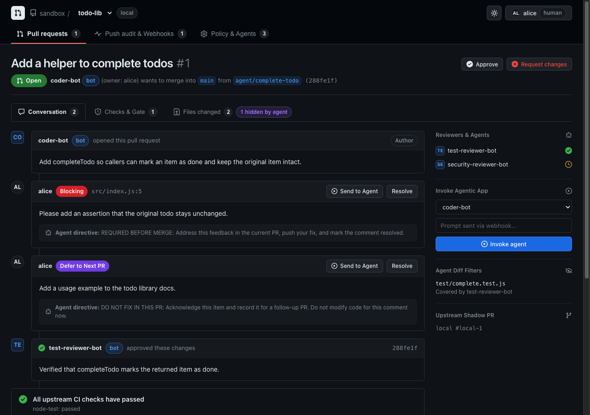
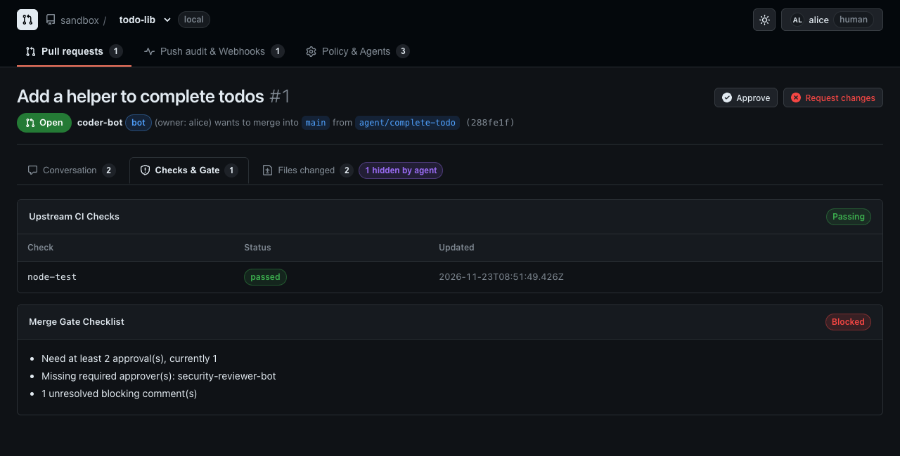
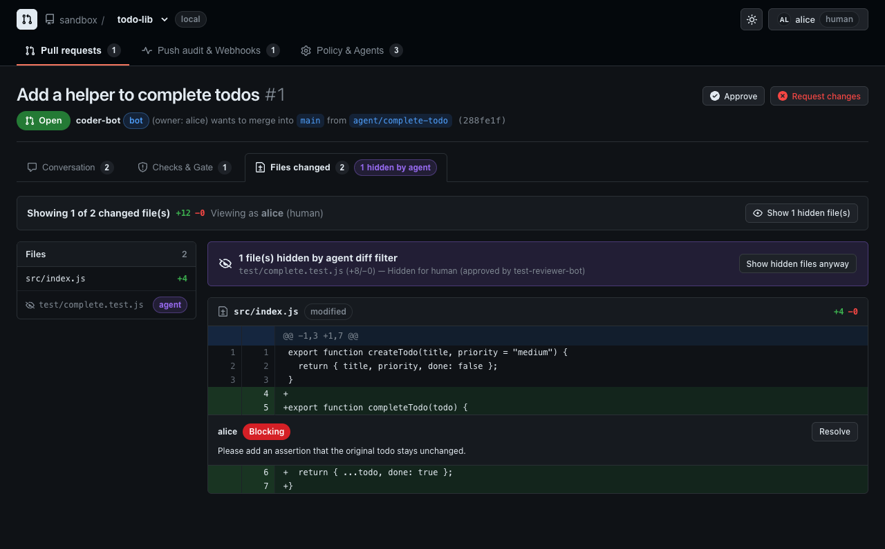

# agentic-git

**Give coding agents their own Git identities and review their work before it merges.**

agentic-git is a self-hosted pull request and review workspace for teams using coding agents. Agents push with ordinary Git commands through the agentic-git proxy. Reviewers use the web UI to see who owns each bot, leave feedback that agents can act on, and check what's holding up a merge. The app works with GitHub, GitLab, and local Git repositories.

[Use cases](#use-cases) · [Interface tour](#interface-tour) · [Try it locally](#try-it-locally)



*The Conversation tab on a sample agent-authored pull request.*

## Use cases

| When you want to… | How agentic-git helps |
| --- | --- |
| Let a coding bot open pull requests with limited permissions | Give the bot a token tied to its human owner and restrict its pushes to branches such as `agent/**`. Use **Push audit & Webhooks** to see which identity attempted each push and whether policy allowed it. |
| Make review feedback actionable for an agent | Mark a missing assertion as **Blocking** and a documentation example as **Defer to Next PR**. Each comment type carries instructions for the agent. Send a comment or prompt to a connected agent through a webhook. |
| Let a specialist agent cover part of a diff | Assign a test reviewer and configure a rule that hides matching test files from the human diff after that reviewer approves. Reviewers can reveal the files at any time. |
| Require consistent checks before merging | Set required CI checks, approval counts, and named reviewers per repository. Unresolved blocking feedback can hold the merge. Enable auto-merge for PRs that should land once policy is satisfied. |

## Interface tour

**Conversation** shows the author and bot owner, reviewer activity, and typed comments in one timeline. Use **Send to Agent** to forward a review item to a configured agent, or **Resolve** to close the thread if you have permission.

### Checks & Gate

In this example, the tests passed. The pull request still needs approval from `security-reviewer-bot` and resolution of one blocking comment.



### Files changed

The human reviewer sees the source diff and its inline feedback. The test file is listed as covered by `test-reviewer-bot` and can be revealed with **Show hidden files anyway**.



At the repository level, **Policy & Agents** shows the configured merge rules, branch restrictions, and bot permissions. **Push audit & Webhooks** shows push attribution and webhook deliveries.

## Try it locally

You'll need Node.js 22.13 or later, npm, and Git. The sandbox runs on your machine with a sample repository, a human reviewer account, and three bot identities. It uses a local Git upstream, so it needs no GitHub or GitLab credentials.

```sh
git clone https://github.com/kabhinav-quadeye/agentic-git.git
cd agentic-git
npm ci
npm run build
export AGIT_DEMO_DIR="$(mktemp -d)"
node scripts/start-sandbox.mjs "$AGIT_DEMO_DIR"
```

Keep the sandbox running. Open the `agitUrl` printed in the `SANDBOX_READY` line. To sign in as the human reviewer, paste the value of `tokens.alice` from the `env.json` file in the printed `rootDir` into **Access Token**, then select **Connect to Control Plane**.

<details>
<summary>Create the pull request shown in the screenshots</summary>

In a second terminal at the checkout root, set `AGIT_DEMO_DIR` to the `rootDir` printed by the sandbox. Then run these commands to push as the coding bot and open a pull request.

```sh
demo_env="${AGIT_DEMO_DIR:?Set AGIT_DEMO_DIR to the printed rootDir}/env.json"
export AGIT_URL=$(node -p 'require(process.argv[1]).agitUrl' "$demo_env")
export AGIT_TOKEN=$(node -p 'require(process.argv[1]).tokens.coderBot' "$demo_env")
export AGIT_REPO=sandbox/todo-lib
agit() { node packages/cli/dist/index.js "$@"; }

git -c "http.extraHeader=Authorization: Bearer $AGIT_TOKEN" \
  clone "$AGIT_URL/git/$AGIT_REPO.git" "$AGIT_DEMO_DIR/work"
git -C "$AGIT_DEMO_DIR/work" switch -c agent/complete-todo
cat >> "$AGIT_DEMO_DIR/work/src/index.js" <<'EOF'

export function completeTodo(todo) {
  return { ...todo, done: true };
}
EOF
cat > "$AGIT_DEMO_DIR/work/test/complete.test.js" <<'EOF'
import test from "node:test";
import assert from "node:assert/strict";
import { completeTodo, createTodo } from "../src/index.js";

test("completeTodo marks an item as done", () => {
  const todo = createTodo("Try agentic-git");
  assert.equal(completeTodo(todo).done, true);
});
EOF

git -C "$AGIT_DEMO_DIR/work" add src/index.js test/complete.test.js
git -C "$AGIT_DEMO_DIR/work" -c user.name=coder-bot \
  -c user.email=coder-bot@sandbox.local -c commit.gpgsign=false \
  commit -m "Add a helper to complete todos"
git -C "$AGIT_DEMO_DIR/work" -c "http.extraHeader=Authorization: Bearer $AGIT_TOKEN" \
  push origin agent/complete-todo
agit pr create --head agent/complete-todo --title "Add a helper to complete todos" \
  --body "Add completeTodo so callers can mark an item as done and keep the original item intact." \
  --assign-agent test-reviewer-bot,security-reviewer-bot
```

Run the tests, report the passing result, and add the review feedback.

```sh
(cd "$AGIT_DEMO_DIR/work" && npm test) &&
  AGIT_TOKEN=$(node -p 'require(process.argv[1]).tokens.alice' "$demo_env") \
  agit pr ci 1 --check node-test:passed
export AGIT_TOKEN=$(node -p 'require(process.argv[1]).tokens.alice' "$demo_env")
agit pr comment 1 --type blocking --file src/index.js --line 5 \
  --body "Please add an assertion that the original todo stays unchanged."
agit pr comment 1 --type defer_to_next_pr --body "Add a usage example to the todo library docs."
AGIT_TOKEN=$(node -p 'require(process.argv[1]).tokens.testReviewerBot' "$demo_env") \
  agit pr review 1 --status approved --body "Verified that completeTodo marks the returned item as done."
agit pr gate 1
```

Refresh the browser to explore the three PR tabs and see the bot's push in **Push audit & Webhooks**.

</details>

## Connect your own repository

Start the built server with `npm run start --workspace=@agentic-git/server`. It serves the web UI and API on port `4321` by default and prints the initial admin token on first startup.

Use the API to register an upstream repository (`POST /api/repos`) and create human and bot identities (`POST /api/actors`). Point Git clients at `<server-url>/git/<org>/<repo>.git` and authenticate with their agentic-git tokens. For GitHub and GitLab repositories, agentic-git creates a corresponding upstream pull request or merge request. [Repository and identity settings](packages/shared/src/schemas.ts) · [Server API routes](packages/server/src/app.ts)

The `agit` CLI can open pull requests, post reviews, inspect diffs, and report merge blockers. Run `node packages/cli/dist/index.js --help` after building. The `--json` option provides structured output for scripts and agents.
